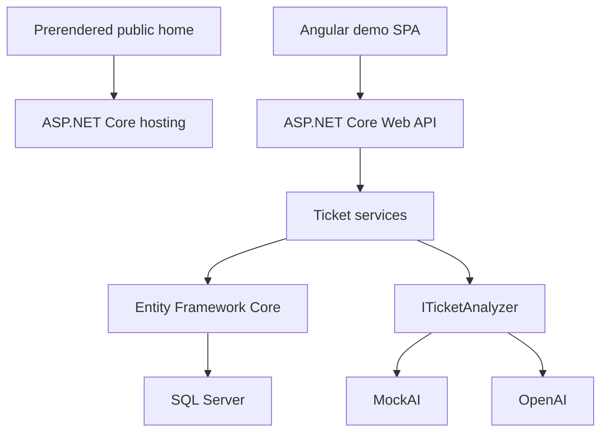

# ResolveDesk AI

ResolveDesk AI is a full-stack support ticket management application built with
ASP.NET Core, Angular and SQL Server. It combines a conventional operational
workflow with provider-independent AI analysis that helps classify incoming
tickets, summarize their content and prepare a suggested response.

**Public presentation:**
[resolvedeskai.anywaresolutions.eu](https://resolvedeskai.anywaresolutions.eu/)

**Interactive demo:** [Open the dashboard](https://resolvedeskai.anywaresolutions.eu/dashboard)

## Overview

The application covers the complete lifecycle of a support request:

```text
Create ticket
-> Review and filter
-> Run AI analysis
-> Update content or classification
-> Resolve
-> Delete
```

AI analysis is persisted and remains connected to the ticket that generated
it. When the source content changes, the application automatically invalidates
the previous analysis so that stale suggestions are never presented as
current.

## Main features

- support ticket creation, detail, editing and deletion;
- status transitions between `Open`, `InProgress` and `Resolved`;
- priority and category management;
- text search and combinable filters;
- operational dashboard with live counts and recent tickets;
- deterministic MockAI provider for development and automated tests;
- OpenAI provider with Structured Outputs;
- persisted AI summaries, classifications and suggested responses;
- automatic invalidation of stale analyses after title or description changes;
- responsive Angular Material interface;
- prerendered public presentation with a canonical URL, robots.txt and sitemap;
- non-indexable demo routes and real HTTP 404 responses for missing pages and tickets;
- unified deployment in which ASP.NET Core serves both the API and Angular SPA;
- health endpoint and development-only Swagger/OpenAPI documentation.

## Architecture



The backend exposes controller-based REST endpoints and keeps persistence,
application services and AI providers separated behind explicit interfaces.
The Angular frontend communicates with the API through `HttpClient` and uses a
development proxy locally.

### AI workflow

`ITicketAnalyzer` keeps the application independent from a specific AI
provider:

- `MockTicketAnalyzer` returns deterministic results for local development and
  tests;
- `OpenAiTicketAnalyzer` uses the OpenAI .NET SDK and Structured Outputs;
- `TicketAnalysisService` coordinates analysis and persistence;
- one analysis is associated with each ticket;
- running the analysis again updates the existing record;
- changing title or description removes the obsolete analysis;
- changing status, priority, category or requester information preserves it.

Only the ticket title and description are sent to the external AI provider.
Requester name and email address remain outside the AI request.

## Technology stack

### Backend and data

- .NET 9
- C#
- ASP.NET Core Web API
- controller-based APIs
- classic `Program.Main` entry point, without top-level statements
- Entity Framework Core 9
- SQL Server
- SQL Server LocalDB for local development
- EF Core Fluent API and migrations
- Swagger/OpenAPI with Swashbuckle

### Frontend

- Angular 21
- standalone components
- strict TypeScript
- Angular Material and Angular CDK
- Angular Router with lazy loading
- Angular Signals and computed signals
- RxJS
- Reactive Forms
- Angular HttpClient
- SCSS

### Applied AI

- OpenAI .NET SDK
- `gpt-4o-mini`
- provider-independent analyzer abstraction
- Structured Outputs with JSON Schema
- deterministic mock provider
- persisted analysis and stale-result invalidation

### Testing

- xUnit
- ASP.NET Core integration testing support
- EF Core InMemory test provider
- Angular unit tests
- Angular `HttpTestingController`
- HTTP integration tests for metadata, crawl directives and 404 responses

## Repository structure

```text
ResolveDeskAI.sln
backend/
|-- ResolveDeskAI.Api/
|   |-- Configuration/
|   |-- Contracts/
|   |-- Controllers/
|   |-- Data/
|   |-- Domain/
|   |-- Hosting/
|   |-- Services/
|   `-- wwwroot/
`-- ResolveDeskAI.Api.Tests/
frontend/
`-- resolve-desk-ai/
    |-- scripts/
    `-- src/
deployment/
|-- README.md
`-- ResolveDeskAI.Migrations.sql
```

`backend/ResolveDeskAI.Api/wwwroot` is generated and ignored by Git. It contains
the prerendered presentation, static error page and Angular demo assets so one
ASP.NET Core application can serve the whole site. Do not edit generated files.

## API endpoints

| Method | Endpoint | Purpose |
|---|---|---|
| `GET` | `/health` | Application health check |
| `GET` | `/api/tickets` | List, search and filter tickets |
| `GET` | `/api/tickets/{id}` | Get one ticket |
| `POST` | `/api/tickets` | Create a ticket |
| `PUT` | `/api/tickets/{id}` | Update a ticket |
| `DELETE` | `/api/tickets/{id}` | Delete a ticket |
| `GET` | `/api/tickets/{ticketId}/analysis` | Get the persisted AI analysis |
| `POST` | `/api/tickets/{ticketId}/analysis` | Run or refresh AI analysis |

The ticket list supports these optional query parameters:

```text
search
status
priority
category
```

## Local development

### Requirements

- .NET 9 SDK
- SQL Server LocalDB or another SQL Server instance
- Node.js 24
- npm 11.6.2

### 1. Restore and prepare the backend

From the repository root:

```bash
dotnet restore ResolveDeskAI.sln
dotnet ef database update \
  --project backend/ResolveDeskAI.Api/ResolveDeskAI.Api.csproj \
  --startup-project backend/ResolveDeskAI.Api/ResolveDeskAI.Api.csproj
```

Build the website once before running the unified site:

```bash
npm ci --prefix frontend/resolve-desk-ai
npm run build:backend --prefix frontend/resolve-desk-ai
```

Run the API and website:

```bash
dotnet run --project backend/ResolveDeskAI.Api/ResolveDeskAI.Api.csproj
```

Development endpoints:

```text
https://localhost:7094/swagger
https://localhost:7094/health
```

The default configuration uses `MockAI`, so no external API key is required.

### 2. Run the Angular frontend

```bash
cd frontend/resolve-desk-ai
npm ci
npm start
```

The development proxy forwards `/api` and `/health` to the ASP.NET Core HTTPS
endpoint. Use the Angular server for UI work; validate production HTTP status
codes against ASP.NET Core, which owns the website route rules.

### 3. Use OpenAI locally

Store the API key with .NET User Secrets rather than in source-controlled
configuration:

```bash
dotnet user-secrets set "AI:OpenAIApiKey" "YOUR_API_KEY" \
  --project backend/ResolveDeskAI.Api/ResolveDeskAI.Api.csproj
```

Run the backend with the `https-openai` launch profile from Visual Studio. The
profile selects the OpenAI provider while the secret supplies the API key.

## Build and test

### Full validation

Build the frontend first: the website integration tests inspect the actual generated
HTML. From the repository root:

```bash
npm ci --prefix frontend/resolve-desk-ai
npm test --prefix frontend/resolve-desk-ai -- --watch=false
npm run build:backend --prefix frontend/resolve-desk-ai
dotnet test ResolveDeskAI.sln --configuration Release
```

### Frontend

```bash
cd frontend/resolve-desk-ai
npm run build
npm test -- --watch=false
```

### Unified production build

From the Angular project directory:

```bash
npm run build:backend
```

This command builds Angular and copies the generated browser assets into:

```text
backend/ResolveDeskAI.Api/wwwroot
```

Angular prerenders `/` and `/not-found` at build time. The copy script removes
scripts from the HTTP error page so it works at any missing URL without trying
to hydrate a ticket component. No Node.js process runs in production.

### Public routing and indexing

| URL | HTTP response | Indexing |
|---|---|---|
| `/` | `200`, prerendered presentation | `index, follow`; canonical `https://resolvedeskai.anywaresolutions.eu/` |
| `/index.html` | `301` to `/` | Consolidated on the home URL |
| `/dashboard`, `/tickets`, `/tickets/new` | `200`, Angular demo shell | `noindex, follow` in HTML and `X-Robots-Tag` |
| `/tickets/{guid}`, `/tickets/{guid}/edit` | `200` if the ticket exists; otherwise `404` | `noindex, follow` |
| `/robots.txt`, `/sitemap.xml` | `200`, public files | Sitemap lists only `/` |
| Unknown URLs, missing assets, `/not-found` | `404`, static error page | `noindex, follow` |
| `/api/*`, `/health` | API responses; unknown APIs return `404` | `X-Robots-Tag: noindex, follow` |

There is no catch-all successful SPA fallback. The server admits known demo routes,
checks ticket existence, and returns `404` elsewhere. Angular's wildcard displays
an error instead of redirecting to the dashboard. Navigation updates title,
robots metadata and canonical together.

`robots.txt` permits crawling, including demo pages: Google must fetch a page to
read `noindex`. See [Google's noindex documentation](https://developers.google.com/search/docs/crawling-indexing/block-indexing).

## Configuration

The default non-sensitive configuration is stored in `appsettings.json`.
Production values are supplied through environment variables, which override
the JSON settings loaded by `WebApplication.CreateBuilder(args)`.

Examples:

```text
ConnectionStrings__DefaultConnection=<production SQL Server connection string>
AI__Provider=OpenAI
AI__OpenAIModel=gpt-4o-mini
AI__OpenAIApiKey=<secret API key>
```

No production secret should be committed to the repository.

## Database migrations

EF Core migrations are stored under:

```text
backend/ResolveDeskAI.Api/Data/Migrations
```

An idempotent SQL Server deployment script is available at:

```text
deployment/ResolveDeskAI.Migrations.sql
```

It can safely initialize a new database or apply only migrations that have not
already been recorded in `__EFMigrationsHistory`.

## Deployment

The production application is hosted on SmarterASP.NET as a single ASP.NET Core
site:

```text
Angular prerender + demo build
-> ASP.NET Core wwwroot
-> Public presentation, REST API and demo
-> SQL Server
-> OpenAI
```

The Visual Studio publish profile uses:

- Release configuration;
- .NET 9;
- framework-dependent and portable deployment;
- ASP.NET Core `OutOfProcess` hosting;
- removal of obsolete destination files;
- a runtime production connection string;
- environment variables for AI configuration and secrets.

Database migrations are applied independently through the idempotent SQL
script, keeping schema deployment explicit and reviewable.

GitHub stores the source code. Publish to SmarterASP.NET using Visual Studio/Web
Deploy or the hosting upload procedure.

`dotnet publish` and Visual Studio publication automatically install locked frontend
dependencies, prerender the public pages and include generated assets. Node.js 24
and npm must be available on the publishing machine.

See [the deployment and Google indexing guide](deployment/README.md) for release
commands, existing profiles, post-deployment checks and Search Console steps.
This SEO change does not require a database migration.

## Project scope

ResolveDesk AI is intentionally focused on a compact, demonstrable support
workflow. Authentication, roles, attachments, notifications, queues and RAG
are outside the current portfolio scope.
